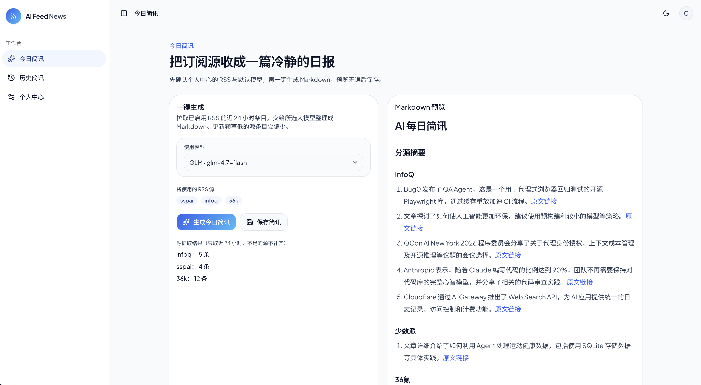

# AI Feed News

[English](README.md) · **中文**

把多个网站的 RSS / Atom 订阅收成**一篇可读的每日简讯**。由你配置的大模型整理成 Markdown，**手动生成、先预览再保存**。

**在线访问：** [ai-feed-news.vercel.app](https://ai-feed-news.vercel.app)

## 产品定位

AI Feed News 是个人向的 **「订阅源 → 大模型 → 每日简讯」** 工作台。你添加常看的站点，设定默认模型，在需要时一键生成结构化日报；**不会自动定时推送**，保存前都可以先看预览。

数据按账号隔离：你的源、你的模型配置、你的历史简讯，没有公共订阅广场或共享时间线。

## 适合谁

- 订阅源多、希望**一个地方**快速浏览今日要点的人
- 想用自己配置的 **LLM 接口**，而不是封闭资讯 App 的人
- 习惯 **Markdown** 阅读、微调或归档的人

## 使用步骤

1. **注册或登录**（邮箱密码；若站点已配置，也可使用 GitHub / Google）。
2. 进入 **个人中心**，添加 RSS 地址并**启用**要参与生成的源（最多 10 个启用源）。
3. 在 **个人中心** 添加至少一套**大模型档案**（厂商、Base URL、模型名、API Key），并设一个为默认。
4. 打开 **今日简讯**：确认默认模型与已启用源，点击 **「生成今日简讯」**。
5. 在右侧 **Markdown 预览** 中检查内容，满意后 **保存**。
6. 在 **历史简讯** 按日期筛选，查看已保存的记录。

### 生成时会怎样

- 从**已启用**的源拉取近期条目（默认偏向近 24 小时；无时间戳时会用最新条目兜底）。
- 交给**默认模型**产出按源分组的中文 Markdown，摘要末尾附原文链接。
- 单个源失败不会拖垮整次生成，错误会在界面上提示，便于你修正地址或重试。

### 小提示

- 先少后多，确认源稳定再扩充列表。
- **先预览、再保存**，避免历史里堆草稿。
- 保持一个明确的默认模型，今日页行为更可预期。
